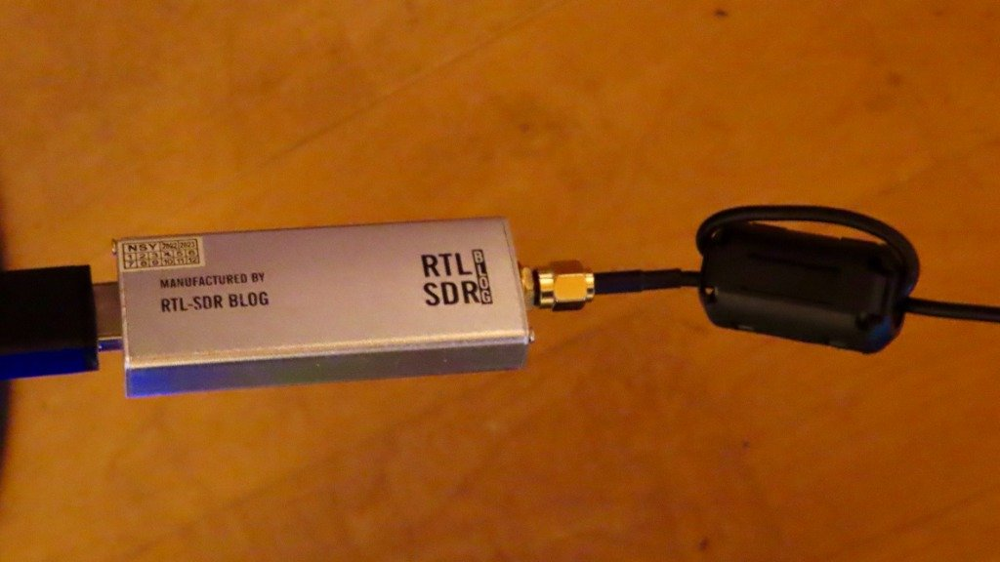
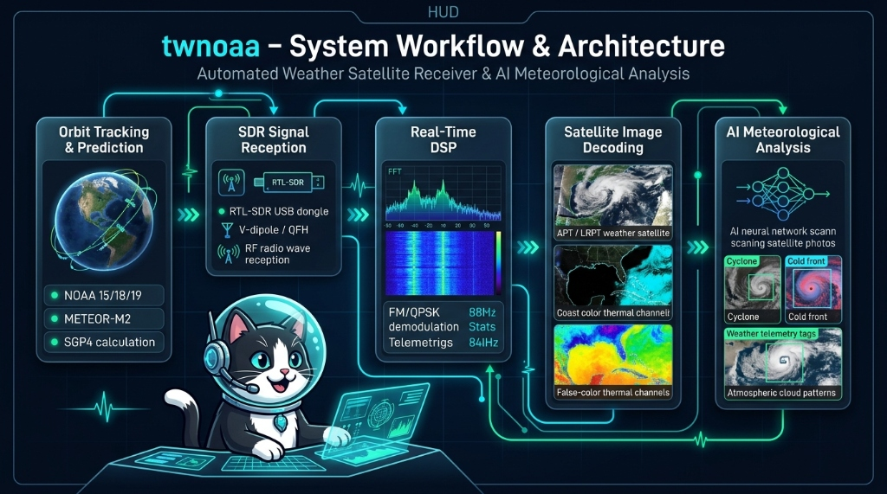
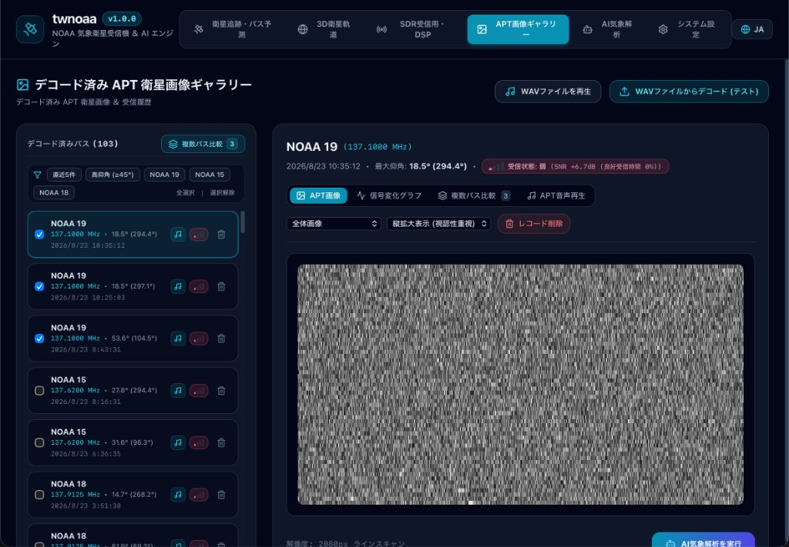
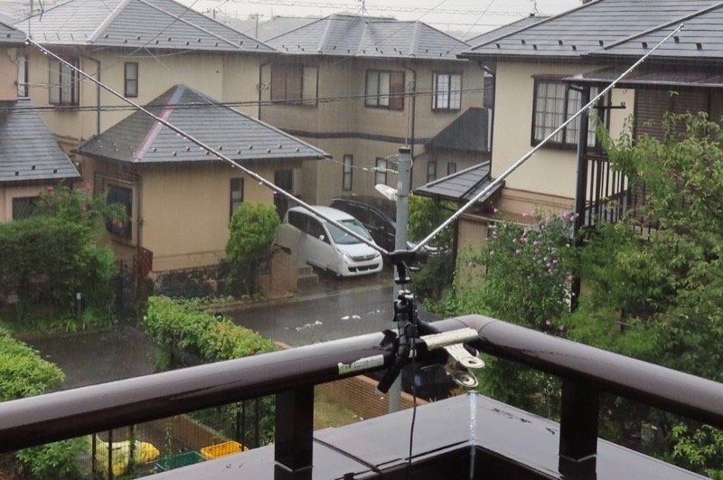
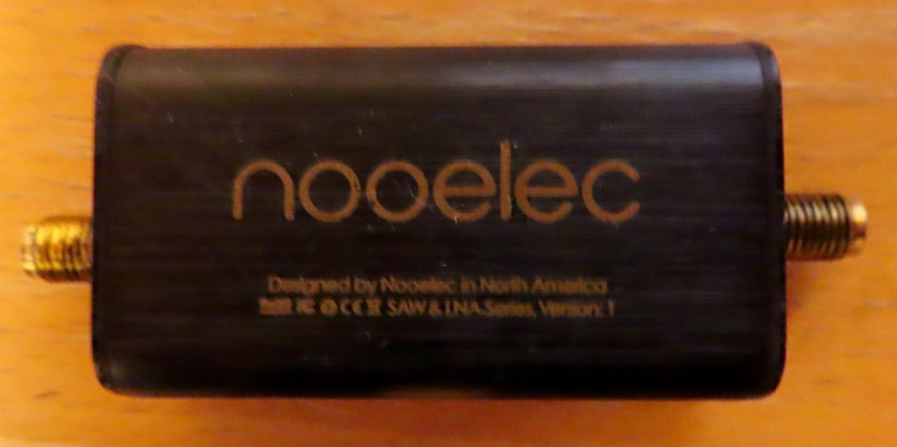
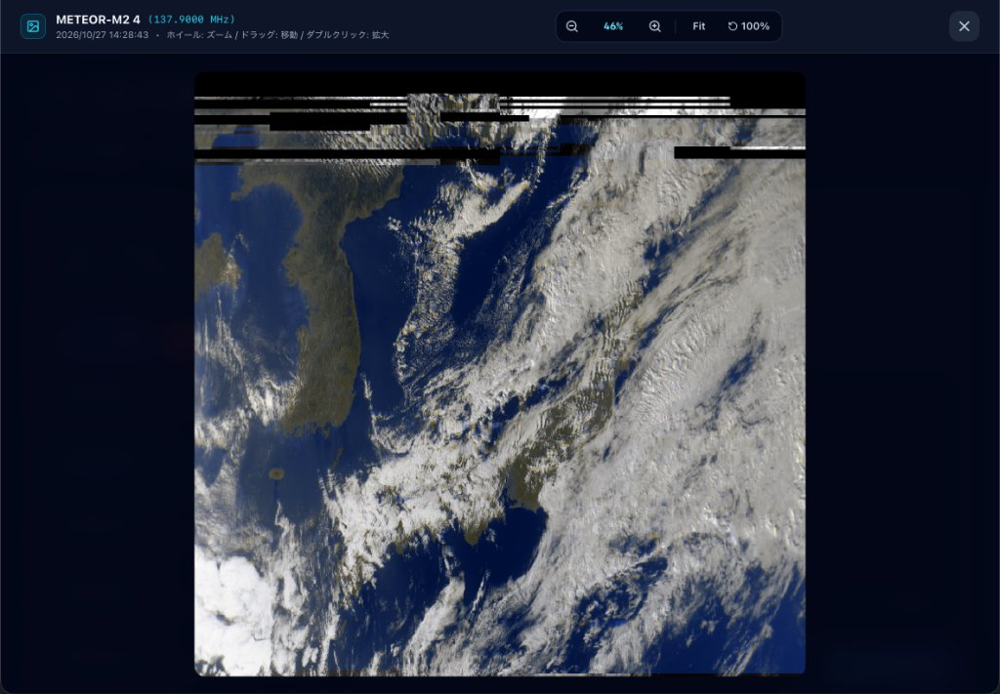
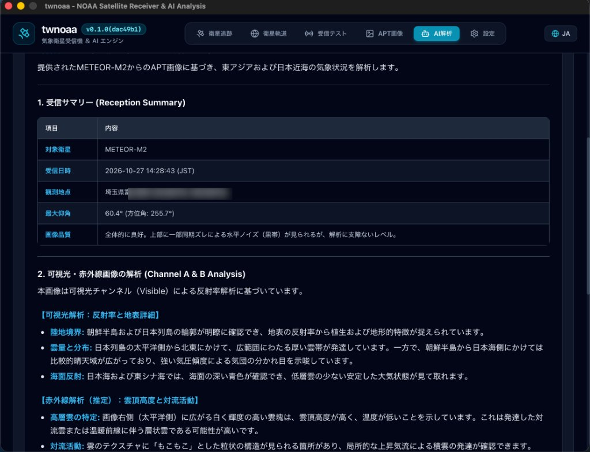
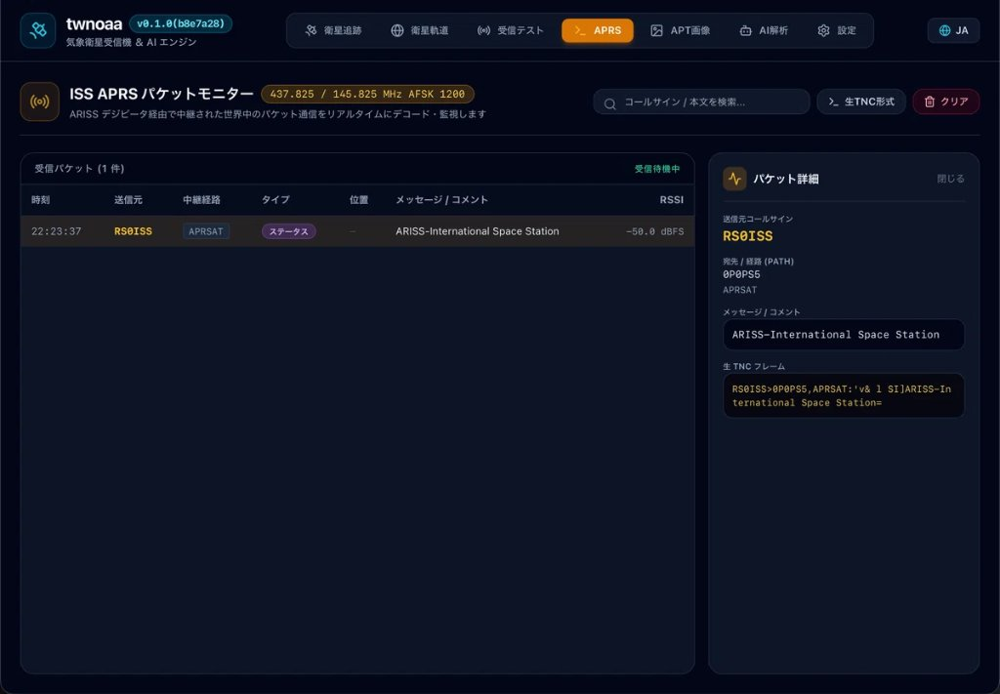

# はじめに

この記事は、[Zennfes Autumn 2026「物理デバイスを使った開発」コンテスト](https://zenn.dev/contests/zennfes-autumn-2026-device)の応募記事です。

普段はオープンソースのネットワーク管理ツール（[TWSNMP](https://twsnmp.sakura.ne.jp/)）を作っている筆者が、数千円のUSBドングル型ソフトウェアラジオ（RTL-SDR）を手に入れたことをきっかけに、AIエージェントを相棒として**「宇宙を飛ぶ気象衛星から電波を直接受信して画像を復元する」**という無謀なツール（**twnoaa**）の開発に挑んだ記録です。

ソフトウェアの世界なら、コードを直せばバグは直ります。しかし相手は**「物理デバイス」**と**「大気・宇宙空間を飛ぶ電波」**。

* 「コードは合っているのに砂嵐しか映らない」
* 「AIと深夜に大喧嘩」
* 「本体より高い9千円の追加機材（LNA）を買うか迷って結局ポチる」
* 「台風と長雨による強制中断」
* 「**1ヶ月間必死に追いかけていた米国の衛星が、実はとっくに電波を止めていた**という衝撃のオチ」
* 「ロシアの気象衛星で起死回生の画像デコード成功」
* 「勢い余って国際宇宙ステーション（ISS）の電波まで受信」

物理世界の洗礼と、AIエージェントとの泥臭い協働開発の全貌をお届けします。

:::message
本連載の元となった実験のリアルタイムな試行錯誤は、noteの連載『[AIといっしょにソフトウェアラジオの実験](https://note.com/twsnmp/n/n287ea4ca0c97)』にも記録しています。あわせてご覧ください。
:::

---

# 1. AIと決めたテーマ：「RTL-SDRで宇宙からの電波をキャッチしたい！」

## 安価なUSBドングル「RTL-SDR」との出会い
秋葉原や通販で数千円で手に入る「RTL-SDR（RTL2832U搭載ドングル）」。もともとは海外向けのワンセグ・テレビチューナー用チップですが、有志の手によって広帯域なソフトウェア無線（SDR: Software Defined Radio）受信機として使えることが知られています。


*▲ 実験に使用した RTL-SDR BLOG 製のUSBドングルとアンテナケーブル*

「このドングルとGo言語を使って、何か面白い物理デバイス連携ツールは作れないだろうか？」

そう思って、日頃ペアプログラミングの相棒にしているAIエージェントに相談を持ちかけました。

FMラジオの受信や航空機の位置情報（ADS-B）受信などいくつかの候補が挙がる中、AIがひときわ熱狂的に提案してきたのがこれでした。

> **AI:** 「宇宙を飛んでいる気象衛星（NOAAなど）は、上空を通過するときに137MHz帯で地球の雲や海を撮影した画像を電波で地上に送信しています。RTL-SDRとアンテナがあれば、自宅のベランダからでもその画像を直接受信してデコードできますよ！」

**「自宅のベランダから、宇宙の衛星の電波を直に拾って画像を復元する」**——。
ロマンの塊のような響きに完全に心を奪われ、開発テーマは即決しました。

---

# 2. 自分では書けない信号処理コードをAIエージェントに作ってもらう

決めたはいいものの、筆者はネットワーク監視ツールの開発経験は豊富ですが、**無線工学やデジタル信号処理（DSP）、周波数変調の復調アルゴリズムなどはまったくの素人**です。

数学的なフーリエ変換（FFT）や直交復調（I/Qデータ処理）、ドップラー効果による周波数補正、さらには受信信号から同期信号（Sync word）を検出して画像を1行ずつ組み立てる処理……。これらをゼロから勉強して自力で実装していたら、何年かかるかわかりません。

そこで、**「アーキテクチャの設計とGo言語のコード生成は全面的にAIエージェントに任せる」**という方針をとりました。


*▲ AIと二人三脚（＋助手の猫さん）で設計・構築した「twnoaa」のシステムアーキテクチャ*

構築したツール「**twnoaa**」の全体フローは以下の通り、電波の受信から画像の復元、さらにはAIによる気象解析までをワンストップで自動化する本格的なパイプラインです。

1. **Orbit Tracking & Prediction（軌道計算）**: SGP4アルゴリズムを用いてNOAAやMeteor衛星の飛来時刻・仰角を自動予測
2. **SDR Signal Reception（電波受信）**: RTL-SDRドングルとアンテナを制御し、衛星通過に合わせてRF信号を受信
3. **Real-Time DSP（リアルタイム信号処理）**: サンプリングデータのFFT解析、FM/QPSK復調、ドップラーシフト補正
4. **Satellite Image Decoding（画像デコード）**: 受信信号からライン同期を取り、APT/LRPTの衛星画像を復元・カラー化
5. **AI Meteorological Analysis（AI気象解析）**: デコードした画像をAI（LLM・ビジョンモデル）に渡し、低気圧や前線、雲のパターンを自動解説

AIは期待以上の働きを見せ、RTL-SDRのCライブラリをGo言語から叩くラッパーを組み、リアルタイムにI/Qサンプルを吸い上げてフィルタリングし、画像を構築するコアロジックを次々と出力してくれました。

「これで宇宙から画像がバンバン降ってくるぞ！」と、助手の猫さんとともに確信していました。
物理世界の過酷さを、まだ何も知らなかったのです。

---

# 3. 現実世界の壁：ノイズ、アンテナ位置、そしてAIとの喧嘩

## 届くのは砂嵐（ホワイトノイズ）ばかり
プログラムをビルドし、気象衛星が自宅上空を通過する時間（軌道予測ツールでチェック）に合わせてアンテナをベランダに出し、受信を実行しました。

しかし、画面に現れるのは**見事なまでの砂嵐（ホワイトノイズ）**。


*▲ 自作した「twnoaa」のWeb UI。100回以上のパス（衛星通過）を自動記録・デコードするも、並ぶのは無情な砂嵐画像（良好受信時間 0%）*

衛星は地上約800kmの上空を秒速7〜8kmで猛スピードで通過していきます。日本上空を跨ぐチャンスは1回につきわずか10分程度。
UIも完璧、バックエンドのGoプログラムもエラーなく完璧に動作し、正常にサンプリングされ、正常にデコード処理が走り……そして**「極めて美しく正確な砂嵐画像」**が淡々とギャラリーに蓄積されていくのです。履歴にはすでに100回を超えるデコードパス（NOAA 15, 18, 19）が虚しく並んでいました。

## 泥沼のトラブルシューティングとAIとの喧嘩
「ソフトウェアは動いているのに、肝心の電波が届いていない」という物理デバイス特有の壁にぶち当たりました。


*▲ ベランダの手すりにクランプで固定したV型ダイポールアンテナ。雨が降りしきる住宅街の空に向けて設置し、試行錯誤が続いた*

* ベランダの手すりにアンテナを固定してみる（角度や向きを微妙に調整）
* 角度（V字ダイポールの開き角約120度や仰角）を変えてみる
* PCのUSBポートからの電磁ノイズを疑い、フェライトコア付きのケーブルを試す
* 部屋のインバーター家電やWi-Fiルーターの電源を切ってみる

衛星が上空を通過するたびにベランダに出て試行錯誤を繰り返すものの、一向に画像は復元されません。深夜や早朝の衛星通過に合わせて眠い目をこすりながら作業し、愛猫に「夜中に何やってるの？」と不審顔で見つめられる日々。

```
私：「言われた通りにアンテナの角度もゲインも調整したけど、相変わらずノイズしか映らないよ！」
AI：「S/N比が足りていません。周辺の障害物による減衰か、アンテナのマッチングが…」
私：「いや、コード側のサンプリングレート設定や復調のしきい値がおかしいんじゃないの！？」
AI：「アルゴリズムの理論計算に問題はありません。ハードウェア側の受信感度を再確認してください」
```

いつまでも成果が出ない焦りから、画面の向こうのAIエージェントと本気で押し問答（喧嘩）をする始末でした。

---

# 4. 「9,000円の機材を買ってください」AIの激推しと葛藤

AIと散々議論した末、AIがある機材を強く推薦してきました。

> **AI:** 「都市部の市街地では電磁ノイズが多すぎます。また、アンテナ単体では微弱な衛星信号が埋もれてしまいます。137MHz帯専用の**LNA（低ノイズアンプ）＋SAWバンドパスフィルター**を導入してください。劇的に改善します」

提示されたのは、Nooelec社の「SAWbird+ NOAA」という専用アンプモジュール。
お値段、**約8,995円（ほぼ9,000円）**。

「待て待て、RTL-SDRドングル自体は数千円で買ったのに、その何倍もする専用アンプを買い足すのか……？」
「もしこれを買っても、うちのベランダのロケーションが悪くて映らなかったら9,000円の文鎮になるのでは……？」

AIと「本当に必要なのか」「アンテナ自作で代用できないか」と散々押し問答を繰り広げました（note記事：『[9千円の機材の購入についてAIと押し問答しています](https://note.com/twsnmp/n/n0c8d1964205c)』）。
しかし、ここまできて引き下がるのも悔しい。ロマンには代えられないと、震える手で購入ボタンをポチりました。


*▲ AIの激推しで購入した Nooelec 社の 137MHz帯専用 SAW & LNA モジュール*

届いたLNAをアンテナとRTL-SDRの間に接続し、バイアスティ（Bias-T）から電源を供給。スペクトラムアナライザで見ると、確かにフロアノイズが下がり、信号のキレが明らかに変わりました。

「これで勝てる！」と確信した矢先、次なる試練が訪れます。

---

# 5. 台風と長雨で強制中断……そして明かされた「衝撃の真実」

## 天候という物理世界の不可抗力
いくら機材が揃っても、相手は空です。
初秋の日本列島を直撃した台風、そして連日の激しい長雨。屋外やベランダに精密機器やアンテナを出すわけにもいかず、実験は約1ヶ月間の強制中断を余儀なくされました。

## 新モデル登場で実験再開、そして……
雨が上がり、ちょうどその頃に新しいAIモデルが登場したため、これまでの実験ログやソースコードをすべて読み込ませて、心機一転「さあ、気象衛星（米国のNOAA-15 / 18 / 19）の受信実験を再開しよう！」と声をかけました。

すると、新しいAIモデルから返ってきたのは、我が目を疑うような回答でした。

> **AI:** 「あ、ひとつ重要な情報をお伝えしなければなりません。あなたが受信しようとしていた米国のNOAA衛星のアナログ画像送信（APT）ですが……**老朽化や米国の運用方針転換（DOGEによる予算見直しの影響等）により、主要な衛星がすでに運用を停止・停波しています**」

**「……は？？」**

思わず声が出ました。

どんなにアンテナを調整しても、
どんなにゲインをいじっても、
9,000円のアンプを挟んでも、
**「そもそも空から電波が出ていなかった」**のです。

1ヶ月以上の間、深夜にベランダに出て蚊に刺されながらアンテナを向け、AIと喧嘩し、ノイズの海を凝視していたあの努力はいったい何だったのか……。
思わず「1ヶ月の無駄な努力はDOGEのせいかもしれない」とnoteに愚痴を書き殴りました。

物理デバイス開発で「対象の機器がそもそも電波を出していない」という根本的な前提の崩壊を、まさかAIとのやり取りで体験するとは夢にも思いませんでした。

---

# 6. 起死回生：ロシアの気象衛星「Meteor-M N2-4」でついに画像が降ってきた！

愕然とする私に、AIがすかさずフォローを入れてきました。

> **AI:** 「安心してください！ 米国のNOAAは停波してしまいましたが、**ロシアの気象衛星『Meteor-M N2-4』なら、現在も137.9MHzでデジタル画像信号（LRPT方式）をバリバリ送信しています！** アナログのAPTより高解像度で鮮明なカラー写真が撮れますよ！」

「早くそれを言ってくれ！」と思いつつも、気を取り直して再挑戦することに。

ただし、NOAAのアナログFM変調（APT）と違い、Meteor-Mは**デジタル変調（QPSK）**です。信号の復調・フレーム同期・リード・ソロモン符号による誤り訂正など、要求されるソフトウェアの難易度は一段跳ね上がります。

しかし、ここはAIエージェントの得意分野。Go言語でのQPSK復調パイプラインをあっという間に組み上げてくれました。

そして迎えた、Meteor-M N2-4の日本上空通過。
ベランダにアンテナを出し、LNAのスイッチを入れ、通過開始の合図とともに受信をスタート。

受信ログに、これまで見たことのない整然としたパケットフレームが次々と記録されていきます。

```text
[INFO] Meteor-M N2-4 signal acquired at 137.900MHz
[INFO] QPSK locked! SNR: 14.2dB
[INFO] Decoding LRPT packets... Frame: 00120/00450 (Error corrected: 100%)
```

そして処理が完了した瞬間、モニターに現れたのがこの画像です。


*▲ ついに受信に成功したMeteor-M N2-4からの気象画像（2026/10/27 14:28 受信）。日本列島と朝鮮半島、日本海、そして列島を覆う白い雲がくっきりと浮かび上がった！*

受信開始直後の上部にわずかな同期乱れがあるものの、中盤から後半にかけて驚くほど鮮明な衛星写真が復元されました。
画面に深い紺色の領域が広がった瞬間、思わず「うわっ、巨大な台風の目か！？」と息を呑んだのですが、AIに冷静に画像を見てもらったところ、**「いえ、それは台風ではなく日本海（海面）ですね」**と即座にツッコミを入れられました（note記事：『[黒いところが台風かと思ったけど海でした](https://note.com/twsnmp/n/n287ea4ca0c97)』）。

さらに本ツール「twnoaa」には、デコードした衛星画像を**ローカルAIに自動で気象解析させる機能**を組み込みました。


*▲ twnoaaの「AI解析」タブ。受信した衛星画像をもとに、ローカルAIが地表の境界や雲頂高度、気圧配置などを即座にレポート*

受信日時や最大仰角（60.4°）、画質サマリーの整理から、可視光・赤外線チャンネルの反射率解析、さらには「太平洋側に広がる厚い雲帯」や「もこもことした対流雲の粒状構造」の特定まで、AIが気象予報士顔負けの分析テキストを自動生成してくれます。

宇宙空間から直接届いた電波が、自宅のベランダのアンテナとドングルを経由して、目の前で美しい地球の姿へと組み上がり、さらにAIがそれを読み解く——。
これまでの数々の失敗、AIとの口論、9,000円の出費のすべてが報われた瞬間でした。

---

# 7. 宇宙への挑戦は続く：同じプログラムで国際宇宙ステーション（ISS）を受信！

気象衛星の電波を受信できたことで、培った受信システムとGo言語プログラムの信頼性は一気に高まりました。

「この受信基盤（RTL-SDR + LNA + 自作Goツール）があれば、宇宙から届く他の電波もキャッチできるのでは？」

次なるターゲットとして選んだのは、地上約400km上空を秒速約7.7kmで周回する**国際宇宙ステーション（ISS）**です。
ISSにはアマチュア無線局（ARISS: Amateur Radio on the ISS）が搭載されており、145.825MHz等で音声通信やパケット通信（APRS / AFSK 1200bps）によるデジピータ中継が行われています。

「気象衛星の信号が受信できるなら、ISSのAPRSパケットもデコードできるはず」と、AIエージェントに頼んで `twnoaa` に**「ISS APRS パケットモニター」機能**を急遽実装してもらいました。

気象衛星用の137MHz帯アンプ（SAWbird+ NOAA）を挟んだまま、アンテナを空に向けてISSの通過を待ち受けたところ……


*▲ twnoaaの「APRS」モニター画面。ISS（RS0ISS）から送出されたリアルタイムのパケットを捉え、見事にデコードに成功！*

夜の22時23分、通過中のISSからの電波をキャッチし、パケットモニターに見慣れたあのコールサインがポップアップしました。

```text
時刻: 22:23:37
送信元コールサイン: RS0ISS
宛先/経路: OP0PS5, APRSAT
メッセージ/コメント: ARISS-International Space Station
生 TNC フレーム: RS0ISS>OP0PS5,APRSAT:'v& 1 SI]ARISS-International Space Station=
```

上空400kmの宇宙空間を飛ぶ有人宇宙ステーションから放たれた電波が、ベランダのV型ダイポールアンテナとRTL-SDRを経由し、AIと作ったGoプログラムでリアルタイムにテキストメッセージへと復元された瞬間でした。気象画像の時とはまた違った、身体が震えるような感動を味わいました。

---

# 8. おわりに：物理デバイス開発における「AIという相棒」のリアル

今回の「RTL-SDR × 気象衛星受信」の挑戦を通じて、ハードウェアや物理デバイス開発におけるAIエージェント活用の大きな可能性と、独特の難しさを学びました。

### 1. 理論と実装はAIが最速で埋めてくれる
DSP（デジタル信号処理）や変調・復調アルゴリズムといった高度な専門知識が必要な領域でも、AIエージェントがいれば数時間でプロトタイプのコードが動きます。一人では絶対に手を出せなかった宇宙通信の世界に飛び込めたのは、間違いなくAIのおかげです。

### 2. 「現実の物理世界」の壁は人間が泥臭く超えるしかない
どれほどAIが完璧なコードを書いても、アンテナの向き、周辺の電磁ノイズ、台風や雨、そして**「そもそも衛星が電波を出しているのか」**といった物理世界の現実は、人間が現場で確かめ、機材を買い、手を動かすしかありません。

### 3. AIを盲信せず、ファクトチェックを怠らない
今回の最大の教訓は「AIは衛星の受信プログラムを完璧に書いてくれるが、その衛星が昨日停波したかどうかは教えてくれない（聞かないと気づかない）」ということでした。物理デバイス開発では、現実のステータス確認こそが一番重要です。

何はともあれ、自宅のベランダと数千円のドングル、そしてAIエージェントという相棒がいれば、個人でも宇宙からの電波を捕まえて画像を取り出せる時代になりました。

物理デバイスとAIの組み合わせは、最高にエキサイティングで、時に大笑いできる最高の趣味です。皆さんもぜひ、手元のハードウェアとAIを繋いで、現実世界へのハックを楽しんでみてください！

---

## 関連リンク
- ツールリポジトリ: [github.com/twsnmp/twnoaa](https://github.com/twsnmp/twnoaa) （開発中）
- note開発日誌: [AIといっしょにソフトウェアラジオの実験](https://note.com/twsnmp/m/m8c8774844391)
